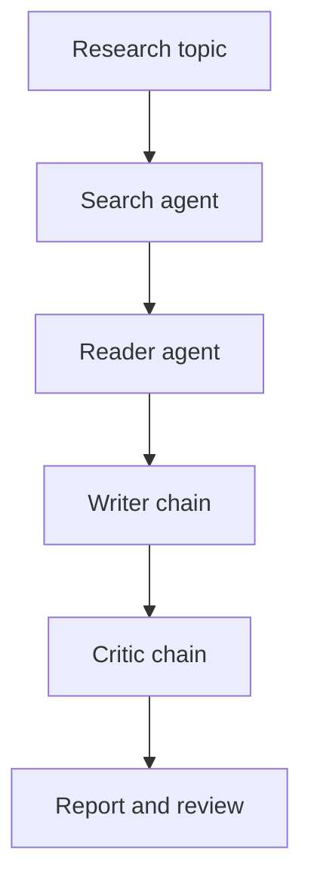

# Quorum: Multi-Agent AI Research Assistant

Quorum is a four-stage research assistant built with LangChain, Mistral AI, Tavily Search and Streamlit.

1. **Search:** discover recent sources and snippets.
2. **Reader:** extract useful content from a selected source.
3. **Writer:** synthesize findings into a structured report.
4. **Critic:** review the report and provide actionable feedback.

## Architecture



## Stack

Python 3.10+, LangChain, LangChain Mistral, Mistral AI, Tavily, Requests, BeautifulSoup, Streamlit and pytest.

## Setup

```bash
git clone https://github.com/sakshamsingh22/quorum-multi-agent-research.git
cd quorum-multi-agent-research
python -m venv .venv
source .venv/bin/activate
# Windows: .venv\Scripts\activate
python -m pip install --upgrade pip
pip install -r requirements.txt
cp .env.example .env
```

Add credentials to `.env`:

```env
MISTRAL_API_KEY=your_mistral_key
TAVILY_API_KEY=your_tavily_key
```

Never commit real credentials.

## Run

```bash
streamlit run app.py
```

CLI:

```bash
python pipeline.py
```

## Tests

```bash
pytest -q
python -m compileall -q .
```

Tests cover input validation and URL safety without paid API calls.

## Repository layout

- `agents.py`: model setup and writer/critic chains
- `pipeline.py`: four-stage orchestration
- `tools.py`: Tavily search and bounded page extraction
- `security.py`: public URL validation
- `app.py`: Streamlit UI
- `tests/`: API-independent tests

## Security and limitations

- Scraping is restricted to HTTP(S) URLs resolving only to public IP addresses.
- Redirects are disabled, response size and extracted text are bounded.
- Live runs require valid Mistral and Tavily credentials.
- Websites may block automated retrieval or render content client-side.
- Model-generated research must be verified against primary sources.
