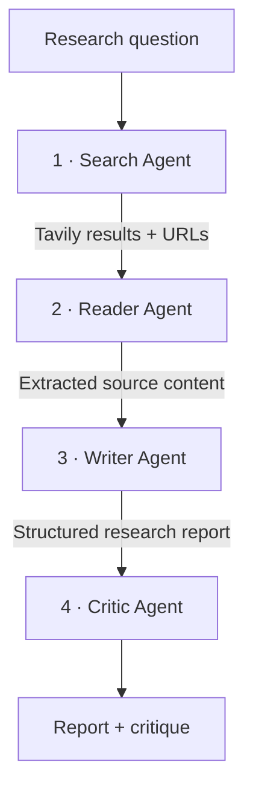
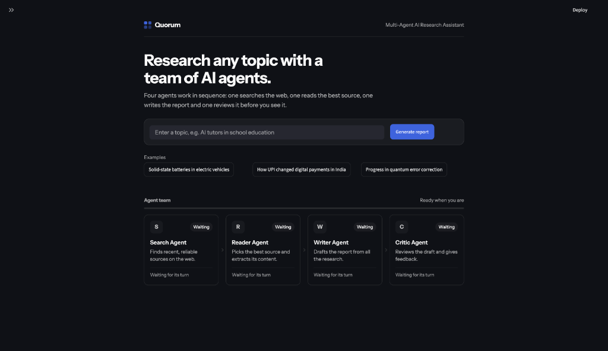
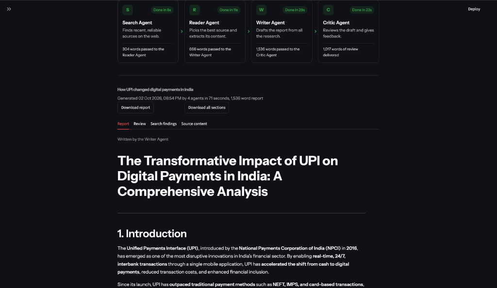
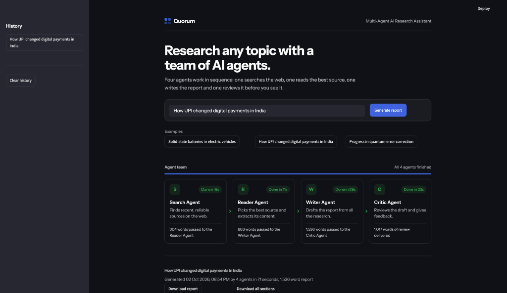

<div align="center">


# QUORUM

### Multi-Agent AI Research Assistant

**From a research question to a structured, source-aware report.**

[](https://www.python.org/)
[](https://streamlit.io/)
[](https://www.langchain.com/)
[](https://mistral.ai/)
[](https://pytest.org/)

[Overview](#-what-is-quorum) · [How it works](#-how-quorum-works) · [Screenshots](#-product-preview) · [Quick start](#-quick-start) · [Security](#-security--responsible-use)

</div>

---

## 🔷 What is Quorum?

Quorum is an experimental multi-agent research assistant that turns a topic into a structured research report through four focused stages. Instead of asking one model to do everything in a single prompt, Quorum separates discovery, source reading, synthesis, and critique into distinct steps.

The goal is simple: make AI-assisted research easier to inspect, easier to follow, and easier to improve.

**Give it a topic. Quorum searches the web, reads a relevant public source, drafts a report, and asks a critic agent to review the result.**

> Quorum is a research prototype, not an autonomous fact-checking system. Always verify important claims against the cited primary sources.

## ✨ What it does

- **Web discovery:** searches for recent and relevant material with Tavily.
- **Source reading:** selects a relevant public URL and extracts bounded page content.
- **Report synthesis:** produces a structured report with an introduction, key findings, conclusion, and source URLs.
- **Critique pass:** evaluates the report and returns a score, strengths, improvement areas, and a verdict.
- **Live workflow view:** Streamlit displays the four agent stages and their progress.
- **CLI pipeline:** run the research flow from a terminal without the Streamlit interface.
- **Input guardrails:** rejects empty or overlong research topics.
- **Outbound URL checks:** restricts page fetching to public HTTP(S) destinations and applies response/time/content limits.
- **API-independent tests:** validates important input and URL-safety behavior without paid model calls.

## 🧠 How Quorum works

Each stage has one responsibility and hands its output to the next stage.



| Stage | Responsibility | Output |
| --- | --- | --- |
| Search Agent | Finds recent information and candidate sources | Titles, URLs, snippets |
| Reader Agent | Selects a relevant public URL and extracts readable content | Bounded source text |
| Writer Agent | Synthesizes the topic and gathered research | Structured report |
| Critic Agent | Reviews the draft constructively | Score, strengths, improvements, verdict |

### Report structure

The Writer Agent is prompted to create:

1. Introduction
2. Key Findings, with at least three explained points
3. Conclusion
4. Sources, listing URLs found during research

The Critic Agent responds with a score out of 10, strengths, areas to improve, and a one-line verdict.

## 🖥️ Product preview

### Research workspace



### Generated research report



### Agent workflow in action



## 🎨 Brand system

Quorum uses a focused dark-interface palette designed for a calm, high-contrast research workspace.

| Token | Color | Hex |
| --- | --- | --- |
| Midnight | <span style="color:#0B1020">■</span> | `#0B1020` |
| Indigo | <span style="color:#6558F5">■</span> | `#6558F5` |
| Cyan | <span style="color:#38D9E6">■</span> | `#38D9E6` |
| Cloud | <span style="color:#F8FAFC">■</span> | `#F8FAFC` |

The repository mark is available as a scalable SVG at [assets/quorum-mark.svg](assets/quorum-mark.svg).

## ⚙️ Technology

| Layer | Technology |
| --- | --- |
| Language | Python 3.10+ |
| User interface | Streamlit |
| Agent orchestration | LangChain agents |
| LLM provider | Mistral AI, `open-mistral-nemo` |
| Web search | Tavily Search |
| Page extraction | Requests + BeautifulSoup |
| Configuration | python-dotenv |
| Tests | pytest |

**Model transparency:** this repository currently configures Mistral's `open-mistral-nemo` model. It is not powered by OpenAI GPT. The Quorum visual identity is an original AI-product brand, not an OpenAI or ChatGPT affiliation.

## 🚀 Quick start

### 1. Prerequisites

- Python 3.10 or newer
- A Mistral API key
- A Tavily API key

### 2. Clone the repository

```bash
git clone https://github.com/sakshamsingh22/quorum-multi-agent-research.git
cd quorum-multi-agent-research
```

### 3. Create and activate a virtual environment

**macOS / Linux**

```bash
python3 -m venv .venv
source .venv/bin/activate
```

**Windows PowerShell**

```powershell
py -m venv .venv
.venv\Scripts\Activate.ps1
```

### 4. Install dependencies

```bash
python -m pip install --upgrade pip
pip install -r requirements.txt
```

### 5. Configure environment variables

Copy the example file:

```bash
cp .env.example .env
```

On Windows, copy it with:

```powershell
Copy-Item .env.example .env
```

Add your own keys to `.env`:

```env
MISTRAL_API_KEY=your_mistral_api_key
TAVILY_API_KEY=your_tavily_api_key
```

Keep `.env` private. Never commit real API keys.

### 6. Launch the Streamlit app

```bash
streamlit run app.py
```

Streamlit prints a local URL in your terminal, usually `http://localhost:8501`.

### 7. Run the command-line pipeline

```bash
python pipeline.py
```

Enter a research topic when prompted. The CLI pipeline returns the stage outputs as a state dictionary.

## 🧪 Run tests

The automated tests focus on input validation and URL safety. They do not call paid Mistral or Tavily APIs.

```bash
pytest -q
python -m compileall -q .
```

The repository also includes a GitHub Actions workflow that installs dependencies, compiles the Python files, and runs pytest for pull requests and configured pushes.

## 🗂️ Project structure

```text
quorum-multi-agent-research/
├── .github/
│   └── workflows/
│       └── ci.yml              # Python CI workflow
├── assets/
│   ├── demo_home.png           # Workspace screenshot
│   ├── demo_report.png         # Report screenshot
│   └── demo_running.png        # Workflow screenshot
├── tests/
│   ├── conftest.py
│   └── test_pipeline.py        # Input and URL-safety tests
├── .env.example                # Required environment variables
├── agents.py                   # Search/reader agents and writer/critic chains
├── app.py                      # Streamlit interface and live stage view
├── pipeline.py                 # Four-stage research orchestration
├── security.py                 # Public URL validation
├── tools.py                    # Tavily search and page extraction
├── requirements.txt
└── README.md
```

## 🔐 Security & responsible use

Quorum fetches pages from URLs selected during research. The current implementation includes several defensive checks:

- Only HTTP and HTTPS schemes are accepted.
- URL credentials and local hostnames are rejected.
- DNS results are checked to reject non-public IP destinations.
- Redirects are disabled for page fetches.
- Requests use a timeout.
- Only HTML and plain-text responses are accepted.
- Download size and extracted text are bounded.

**Important limitations**

- DNS validation before the request is not a complete defence against DNS rebinding or every network-layer attack. Use deployment-level outbound network restrictions as an additional control.
- Search results and scraped page content are untrusted input. Treat prompt-injection attempts and misleading source text as possible.
- A critic score is a model-generated review, not a calibrated factuality score.
- The Writer Agent can produce unsupported statements. Check the source URLs and independently verify important claims.
- Website availability, robots policies, and content structure can affect extraction.
- Live research requires valid external API credentials and may incur provider costs.

## 🧭 Roadmap

- [ ] Add explicit source selection and source-by-source citations in report sections.
- [ ] Add configurable research depth and source limits.
- [ ] Preserve a structured research trace for reproducibility.
- [ ] Add retry and timeout policies for individual stages.
- [ ] Add evaluation fixtures for report quality and source attribution.
- [ ] Add deployment documentation and a verified hosted demo.
- [ ] Add per-session state isolation and observability for hosted use.

## 🤝 Contributing

Issues and pull requests are welcome. For a meaningful change:

1. Open an issue describing the problem or proposed improvement.
2. Create a focused branch.
3. Add or update tests where behavior changes.
4. Run `pytest -q` and `python -m compileall -q .`.
5. Open a pull request with a clear summary and validation notes.

## 📄 License

No license is currently declared in this repository. Unless a license is added, all rights remain with the copyright holder and reuse is not automatically granted.

---

<div align="center">

**QUORUM** · Think in stages. Research with evidence.

Built by **[Saksham Singh](https://github.com/sakshamsingh22)**

[GitHub Repository](https://github.com/sakshamsingh22/quorum-multi-agent-research)

</div>
